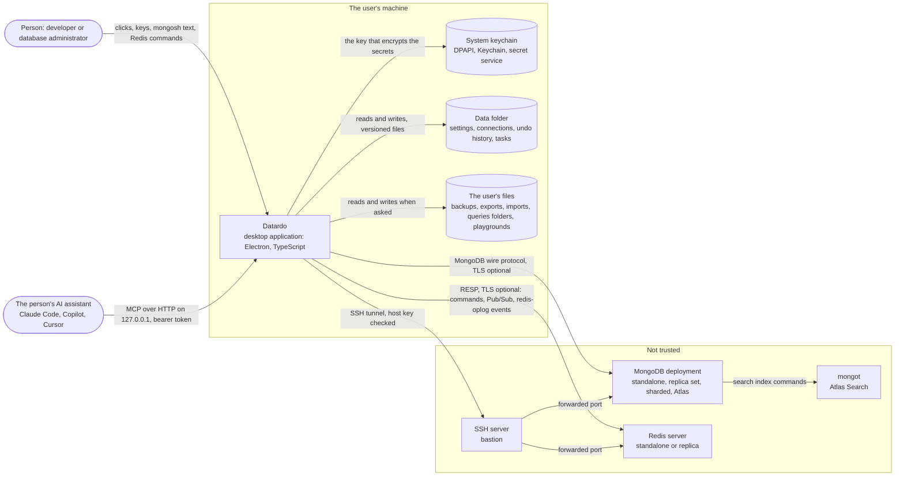
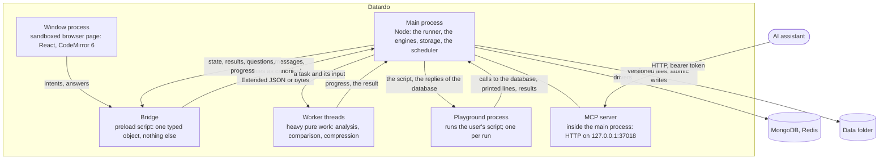

# Architecture

How Datardo's code is organized, what may use what, and how a click becomes an effect. The rules that keep this shape
are in [code-rules.md](code-rules.md); the shape of a feature is in the [feature contract](feature-contract.md); the
commands to build and test are in [testing.md](testing.md).

## What "dependencies from a list" means

A dependency is any package that ends up in the application. Only the packages decision
[D22](decisions.md#d22--dependencies-from-a-list-with-their-licenses-checked) lists may be imported, each from the
folders that may use it: the drivers (`mongodb`, `redis`, `ssh2`) only in `src/engines`, React and the editor only in
`src/ui`, Electron only in `src/main` and `src/preload`. Everything is bundled; nothing is downloaded when Datardo
runs. Tools of the build and of the tests (TypeScript, Vite, ESLint, Vitest, Playwright) are not dependencies in this
sense, and are pinned by the lockfile like the rest.

## Context

*C4 level 1: who and what Datardo talks to.* The boxes in **Not trusted** send Datardo data it must not run or believe
blindly; the [security page](security.md) starts from this picture.



## Containers

*C4 level 2: the pieces that run separately, and what passes between them.*



Levels 1 and 2 change rarely: update them in the commit that adds an external system or a running piece. Level 3 is
the modules below; level 4 is the code.

## Modules

```
src/
  shared/       Pure, used everywhere. Values and their text: mongosh syntax, Extended JSON, Redis replies and bytes.
                The types every part shares: Connection, Target, Context, Outcome, Plan, Step, Refusal.
                The messages of the bridge. The app's state and the one function that changes it.
  features/     Pure. One folder per area of the catalog, one module per card. commands.ts registers every command.
  engines/      Main process only. The Engine interface, and one folder per engine that implements it:
                mongodb/ and redis/ (connect, test, run a request, run a step, say what the server can do).
                transport/ holds what engines share: TLS options and the SSH tunnel.
  runner/       Main process only. Carries out what features return: questions, reads, refusals, the confirmation,
                recording the undo, the steps, publishing for redis-oplog, the Log, work in progress, cancellation.
                workers/ runs heavy pure functions on worker threads.
  storage/      Main process only. The data folder: versioned JSON files written atomically, their migrations,
                the secret storage, the files of the undo history.
  main/         The main process: start, one instance, the window and its frame, the bridge's other end, the tray,
                the scheduler of tasks, and mcp/, the MCP server.
  preload/      The bridge: exposes one typed object to the window process.
  ui/           The window process. shell/ draws the window (top bar, rail, explorer, main island, inspector island,
                status line, dialogs, notifications); pages/ has one folder per area that has a page; components/
                has the pieces pages share (table, editor, tree, menu, form fields); theme/ has the tokens and the
                themes; state/ mirrors the main process's state.
resources/      settings.schema.json, the icon font, the application's icons.
test/           unit/, integration/, ui/, fixtures/ (recorded replies, old stored files).
scripts/        check.mjs runs every check; catalog.py checks the catalog and writes its index; roadmap.py writes
                the roadmap's lists of cards; notices.mjs writes the licenses' notices.
docs/           These documents.
```

### Who may use whom

```
ui ───────► features ───────► shared
 │             ▲                ▲
 └─────────────┼────────────────┤
preload ───────┼────────────────┤   (types only)
main ──► runner ──► engines ────┤
  │        │  └───► storage ────┤
  │        └──────► features    │
  └──► storage, engines, features, shared
```

- `shared` imports nothing of the project and only pure libraries (`json5`, `acorn`).
- `features` imports `shared` only: no Electron, no driver, no DOM, no Node API, no clock. It runs the same in the
  main process, in the window process and in a test.
- `engines` is the only place that imports a driver. An engine never imports another engine.
- `runner` is the only place that calls an engine to write. It knows no feature by name: it looks them up by
  identifier.
- `ui` imports `features` (the views and the commands) and `shared`, never `main`, `runner`, `engines` or `storage`.
  What it needs from them comes through the bridge.
- `main` wires the others together and holds no feature's logic.

An import that breaks these fails the check ([R1.3](code-rules.md#r1--dependencies-and-layers)).

## From an action to its effect

1. The user clicks a control that carries `data-feature="document.delete@row-menu"`, or runs a command, or an AI
   assistant calls a tool. The window process sends an **intent** through the bridge: the feature's identifier, the
   place, and the target (the connection, the collection, the document's `_id`).
2. The runner builds the **context**, an immutable snapshot, and calls the feature's function.
3. The feature returns an outcome. For **ask**, the runner sends the question to the window, which shows a dialog and
   returns the answer. For **read**, the runner calls the Read feature's `request`, gives it to the engine, and passes
   the reply to its `parse`. Then it calls the feature again with what was learned.
4. For **refuse**, the window shows the message, the Log records the code, and nothing else happens.
5. For **run**, the runner checks the read-only guard, shows the confirmation the plan's danger asks for, saves what
   the undo history must keep, runs the steps through the engine one by one, writes each in the Log, and publishes
   for redis-oplog when the plan says so.
6. The runner does what the plan says follows: it reads again what the open pages show, and sends a notification.
7. The main process changes its state through the one reducer, and sends the change to the window, whose views are
   computed again from it.

Nothing in this flow is particular to a feature: a new feature is a new function and a new card.

## Processes and threads

| What | Runs in | Talks to the others by |
| --- | --- | --- |
| The runner, the engines, storage, the scheduler, the MCP server | the main process (Node) | function calls; the bridge to the window |
| Drawing, typing, the views | the window process (a sandboxed page) | the bridge: intents and answers out, state and results in |
| Schema analysis, comparisons, CSV, compression of backups | worker threads of the main process | a message with the input, messages with progress, one with the result |
| A query, a scan, a step | the main process, awaiting the driver | an `AbortSignal` to cancel |
| The code of a playground | a process of its own, started for the run and ended by **Stop** | messages: each call to the database goes to the main process, which runs it through the engine |

The window process never waits for the main process: every call through the bridge is asynchronous, and anything that
can take longer than a moment shows as work in progress.

## State

- The **app's state** lives in the main process: the saved connections and their states, the open tabs and their
  groups, the pins, the settings, the work in progress, the notifications. It changes only through
  `reduce(state, event)` in `src/shared/state`, a pure function, and each change is sent to the window.
- The **window's own state** is what is lost without harm: what is hovered, where a list is scrolled, the text being
  typed in a field before it is run.
- The **results** of reads (the documents of a page, the keys of a scan) are sent to the window for the tab that asked
  and are not kept in the main process.
- What is **persisted**, and how, is in [data.md](data.md).

## Values

- MongoDB values cross the bridge as canonical Extended JSON, so that `Int32` and `Double`, `Long` and `Decimal128`
  stay apart. The window formats them as mongosh syntax with `src/shared/mongosh`. Documents are read from the driver
  without promoting values.
- Redis values cross as bytes. The window decides how to show them (`value.format`): text, JSON or hexadecimal.
- Text from the user (a filter, a pipeline, a command line) crosses as text and is parsed in the main process by the
  same `src/shared` code the window uses to color and complete it. It is never evaluated.

## Drawing

React draws the window. A page is a component that takes the result of its View function and draws it, and sends
intents; it holds no rule of the product. Tables draw only the rows on screen. Every color, radius, space and font
size is a token of `src/ui/theme/tokens.css`; a theme and the color of a connection are sets of tokens. Icons come from
the Codicons font. The editor is CodeMirror 6, with one set of extensions for mongosh syntax and one for Redis
commands.

## Long work and cancellation

Every read and every step has a time limit, named on its card, and takes an `AbortSignal`. Work on many items runs in
batches and checks for cancellation between them; a cancelled plan stops after the batch in progress and says how far
it went. Work in progress is part of the app's state, so the status line shows it and **Cancel** reaches it.

## Where things are

| You want to change | Look in |
| --- | --- |
| What a feature asks, refuses or runs | `src/features/<area>/<action>.ts`, and its card in `docs/features/<area>.md` |
| How a page looks | `src/ui/pages/<area>/`, and the tokens in `src/ui/theme/` |
| The window's frame, the islands, dialogs, notifications | `src/ui/shell/`; the frame per platform in `src/main/window.ts` |
| How a command is sent to MongoDB or Redis | `src/engines/mongodb/`, `src/engines/redis/` |
| TLS options, the SSH tunnel | `src/engines/transport/` |
| The confirmation, the order of what happens around a write | `src/runner/` |
| mongosh syntax, Extended JSON, how bytes are shown | `src/shared/` |
| A stored file, its version, a migration | `src/storage/`, and [data.md](data.md) |
| A command, its title, its key | `src/features/commands.ts` |
| A setting | `resources/settings.schema.json`, and [features/settings.md](features/settings.md) |
| A tool of the MCP server | `src/features/mcp/`, served by `src/main/mcp/` |
| The messages between the window and the main process | `src/shared/bridge.ts`, `src/preload/` |
